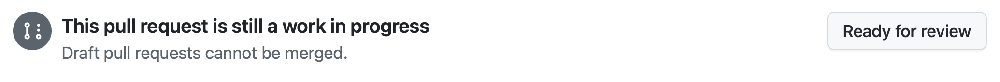

| [← Lección anterior: Gestionar agentes][previous-lesson] |
|:--|

## Revisar el trabajo

Durante este laboratorio has trabajado con GitHub Copilot en varias tareas para mejorar la experiencia de usuario y añadir funcionalidades. Le pediste que documentara el código, creara una sección de juegos relacionados y añadiera funciones de accesibilidad, incluidos los modos de alto contraste y claro. Ahora revisarás los cambios y, si es necesario, darás indicaciones a Copilot para mejorarlos.

### Escenario

Como ya hemos señalado, los fundamentos del diseño de software y DevOps no cambian al incorporar IA generativa. Siempre hay que revisar el código generado y seguir el proceso habitual de desarrollo y operaciones. Revisa las propuestas de GitHub Copilot para la documentación, los juegos relacionados y las funciones de accesibilidad antes de habilitar las revisiones del resto del equipo.

## Seguridad y agente de GitHub Copilot en la nube

Como el agente de Copilot en la nube trabaja de forma asíncrona y sin supervisión, se han establecido medidas de seguridad:

- Copilot solo tiene acceso de lectura al repositorio y acceso de escritura **únicamente** a la rama que utilizará para el código.
- El agente trabaja en GitHub Actions, dentro de un entorno independiente y efímero.
- Para ejecutar los flujos de trabajo de GitHub Actions, primero se necesita la aprobación de una persona.
- [El acceso a recursos externos está limitado de forma predeterminada](https://docs.github.com/copilot/how-tos/copilot-on-github/customize-copilot/customize-cloud-agent/customize-the-agent-firewall), incluidos los servidores MCP.

## Revisar la documentación generada

Empieza por la primera solicitud de incorporación de cambios (PR) que generó el agente de Copilot en la nube: la que añade documentación al código. La revisarás con la interfaz habitual de PR de GitHub.com.

> [!NOTE]
> Es posible que la PR muestre un aviso de que el firewall ha bloqueado a GitHub Copilot. Es lo esperado, ya que el acceso del agente a recursos externos, incluidas las llamadas a servidores MCP externos, está limitado de forma predeterminada. Si quieres, puedes [personalizar o deshabilitar el firewall del agente de Copilot en la nube][agent-firewall].

1. Vuelve al repositorio en github.com.
2. Selecciona **Pull Requests** para abrir la lista de PR.
3. Abre la solicitud cuyo título sea parecido a **Falta documentación en el código**.

> [!NOTE]
> Si Copilot todavía está trabajando, la PR incluirá la etiqueta **[WIP]**. Espera a que termine; puede tardar unos minutos.

4. Cuando la PR esté lista, selecciona **Files changed** y revisa los cambios.

   

5. Explora el código actualizado, que incluirá comentarios TSDoc y otra documentación. Los cambios concretos pueden variar. Busca comentarios TSDoc, convenciones de TypeScript y encabezados de comentario; proceden de los archivos de instrucciones que revisaste al principio del ejercicio 2.
6. Cuando hayas revisado los cambios, vuelve a la pestaña **Conversation** y desplázate hacia abajo.
7. Comprueba si hay un indicador que señale que algunos flujos de trabajo esperan aprobación.
8. Si los hay, selecciona **Approve and run workflows**.

   

9. Los flujos de trabajo aparecerán en la sección de comprobaciones de la PR. Si todo va bien, las comprobaciones del proyecto para la aplicación Astro se superarán. El proceso puede tardar unos minutos.

## Pedir cambios a GitHub Copilot

La colaboración con Copilot no es un proceso unidireccional. Puedes mencionarlo en comentarios de la PR o en comentarios insertados en el código, como harías con otros miembros del equipo. Copilot verá el comentario e iniciará otra sesión para resolverlo. Como los resultados no son deterministas, no hay un prompt único que debas utilizar. Por ejemplo, podrías pedirle que:

- añada al principio de cada archivo de código un encabezado con una descripción breve.
- añada comentarios de documentación TSDoc a los archivos TypeScript y Astro.
- cree un README que describa la estructura de la aplicación Astro.

1. Añade un comentario para solicitar un cambio en la documentación generada y menciona a **@copilot**. Puedes usar una de las ideas anteriores u otra mejora de documentación que quieras ver en el código.
2. Selecciona **View Session** para observar el trabajo. Copilot iniciará una sesión nueva para realizar los cambios.
3. Selecciona **Back to pull request** para volver a la solicitud.

   

4. Cuando Copilot termine, aparecerá una confirmación nueva en la PR.
5. Selecciona **Files changed** y revisa los cambios.

Puedes seguir iterando hasta que estés conforme. Después, convierte la PR en lista para revisión y combínala en la rama principal.



## Revisar la funcionalidad de juegos relacionados

Vuelve a la PR que Copilot creó para resolver la incidencia sobre los juegos relacionados en la página de detalles.

1. Ve al repositorio en GitHub.com.
2. Selecciona la pestaña **Pull Requests**.
3. Selecciona la PR cuyo título sea parecido a **Mostrar juegos relacionados en la página de detalles**.
4. Selecciona **Files changed** y revisa el código generado.
5. Cuando hayas revisado los cambios, vuelve a la pestaña **Conversation** y desplázate hacia abajo.
6. Comprueba si hay un indicador que señale que algunos flujos de trabajo esperan aprobación.
7. Si los hay, selecciona **Approve and run workflows**.

   

8. Los flujos de trabajo aparecerán en la sección de comprobaciones de la PR. Si todo va bien, las comprobaciones del proyecto para la aplicación Astro se superarán. El proceso puede tardar unos minutos.
9. **Opcional:** puedes cambiar a la rama del agente en tu Codespace y probar manualmente la funcionalidad de juegos relacionados. Abre un terminal y ejecuta estos comandos; sustituye `<branch-name>` por el nombre de la rama creada por Copilot, por ejemplo, **copilot/fix-8**:

   ```bash
   git fetch origin
   git checkout <branch-name>
   ```

Copilot ha creado la funcionalidad de juegos relacionados. Como antes, puedes pedir al agente que haga cambios, por ejemplo, para ajustar cuántos juegos relacionados se muestran o añadir encabezados y comentarios TSDoc. Recuerda que esta tarea se asignó **antes** de actualizar las instrucciones personalizadas. Añade un comentario nuevo en la pestaña **Conversation** y Copilot iniciará otra sesión para atenderlo.

## Revisar las funciones de accesibilidad

Por último, revisa las funciones implementadas con el agente personalizado de accesibilidad. La PR debe incluir tanto el modo de alto contraste que asignaste en el ejercicio 3 como el modo claro que solicitaste desde Mission Control en el ejercicio 4.

1. Ve al repositorio en GitHub.com.
2. Selecciona la pestaña **Pull Requests**.
3. Selecciona la PR cuyo título sea parecido a **Añadir un modo de alto contraste al sitio**.

> [!NOTE]
> Si Copilot todavía está trabajando en la tarea, la PR incluirá la etiqueta **[WIP]**. Espera unos minutos a que termine.

4. Selecciona **Files changed** y revisa el código generado.
5. Revisa la implementación y presta especial atención a:
   - los componentes de interfaz para cambiar entre modos.
   - el uso del almacenamiento local para conservar las preferencias.
   - los cambios de CSS o estilos para los modos de alto contraste y claro.
   - los atributos de accesibilidad, como las etiquetas ARIA y la navegación con teclado.
   - el código JavaScript o TypeScript que gestiona el cambio de modo.

6. Cuando hayas revisado los cambios, vuelve a la pestaña **Conversation** y desplázate hacia abajo.
7. Comprueba si hay un indicador que señale que algunos flujos de trabajo esperan aprobación.
8. Si los hay, selecciona **Approve and run workflows**.

   

9. Los flujos de trabajo aparecerán en la sección de comprobaciones de la PR. Si todo va bien, las comprobaciones del proyecto para la aplicación Astro se superarán. El proceso puede tardar unos minutos.
10. **Opcional:** puedes cambiar a la rama del agente en tu Codespace para probar manualmente las funciones de accesibilidad. Abre un terminal y ejecuta estos comandos, sustituyendo `<branch-name>` por el nombre de la rama creada por Copilot:

   ```bash
   git fetch origin
   git checkout <branch-name>
   ```

   Después, inicia la aplicación y prueba los conmutadores de alto contraste y modo claro en el navegador. Comprueba que funcionan y que las preferencias se conservan al recargar la página.

El agente personalizado de accesibilidad ayudó a Copilot a implementar estas funciones siguiendo prácticas de accesibilidad. Si encuentras algún problema o mejora, puedes mencionarlo en un comentario a **@copilot**, como hiciste con las PR anteriores.

## Ejercicio opcional: seguir delegando

El agente en la nube es útil para delegar tareas reales del backlog y ocuparte de otros asuntos mientras trabaja. Para practicar este flujo, registra más incidencias en tu repositorio y asígnaselas a Copilot. Algunas ideas:

- crear un formulario de interés de patrocinadores en la página de detalles de un juego.
- implementar la paginación en la página de lista de juegos.
- añadir validación de entradas y gestión de errores a los helpers de acceso a datos.

## Resumen

Has completado el itinerario del agente en la nube. Durante estas lecciones:

- **Has inspeccionado los archivos de instrucciones personalizados del repositorio** para entender su efecto en el trabajo del agente.
- **Has asignado incidencias al agente de Copilot en la nube** y has observado cómo prepara el entorno, planifica y trabaja de forma asíncrona.
- **Has creado y utilizado un agente personalizado** de accesibilidad para añadir modos de alto contraste y claro.
- **Has utilizado la página de agentes de Copilot como Mission Control** para supervisar y dirigir la sesión de accesibilidad.
- **Has revisado las PR del agente e iterado sobre ellas**, mencionando a `@copilot` para solicitar cambios y aprobando flujos de trabajo.

## Repaso y pasos siguientes

Has completado el itinerario del agente en la nube. Para seguir aprendiendo, puedes complementar lo que has practicado con otros itinerarios:

- 🖥️ **[Itinerario de VS Code](../../vscode/)**: explora el modo agente de Copilot Chat y la integración con MCP directamente desde el IDE.
- 💻 **[Itinerario de CLI](../../cli/)**: publica dos cambios revisados desde el terminal con Plan y Autopilot, habilidades de agente, un agente de QA personalizado, Playwright MCP, Agent Merge y la opción de delegar tareas al agente en la nube con `/delegate`.

En tu propio repositorio, prueba estas ideas:

- asignar al agente una incidencia de refactorización o cobertura de pruebas.
- crear un agente personalizado para otro ámbito.
- configurar `copilot-setup-steps.yml` para otra pila tecnológica.

## Recursos

- [GitHub Copilot][github-copilot]
- [Acerca de los agentes de Copilot][copilot-agents]
- [Asignar incidencias de GitHub a Copilot][assign-issue]
- [Buenas prácticas para el flujo de configuración del agente en la nube][cloud-agent-best-practices]
- [Configurar el firewall del agente de Copilot en la nube][agent-firewall]

---

| [← Lección anterior: Gestionar agentes][previous-lesson] |
|:--|

[github-copilot]: https://github.com/features/copilot
[cloud-agent-overview]: https://docs.github.com/copilot/concepts/agents/cloud-agent/about-cloud-agent
[assign-issue]: https://docs.github.com/copilot/how-tos/use-copilot-agents/cloud-agent/start-copilot-sessions
[setup-workflow]: https://docs.github.com/copilot/how-tos/copilot-on-github/customize-copilot/customize-cloud-agent/customize-the-agent-environment
[copilot-agents]: https://docs.github.com/copilot/concepts/agents/cloud-agent/about-cloud-agent
[cloud-agent-best-practices]: https://docs.github.com/copilot/how-tos/copilot-on-github/customize-copilot/customize-cloud-agent/customize-the-agent-environment
[agent-firewall]: https://docs.github.com/copilot/how-tos/copilot-on-github/customize-copilot/customize-cloud-agent/customize-the-agent-firewall

[previous-lesson]: ../4-managing-agents/
